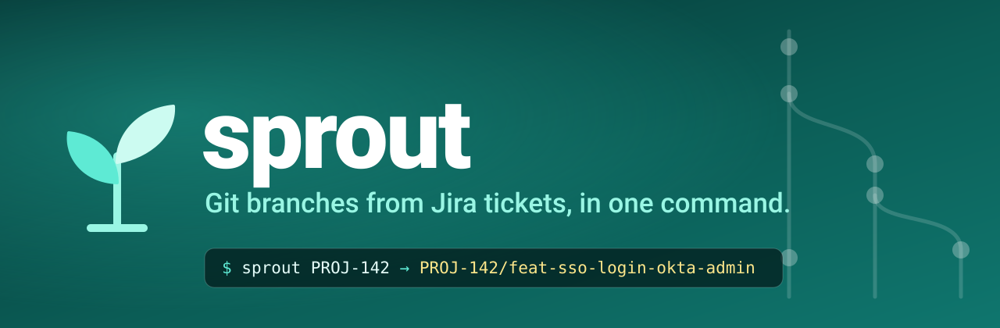
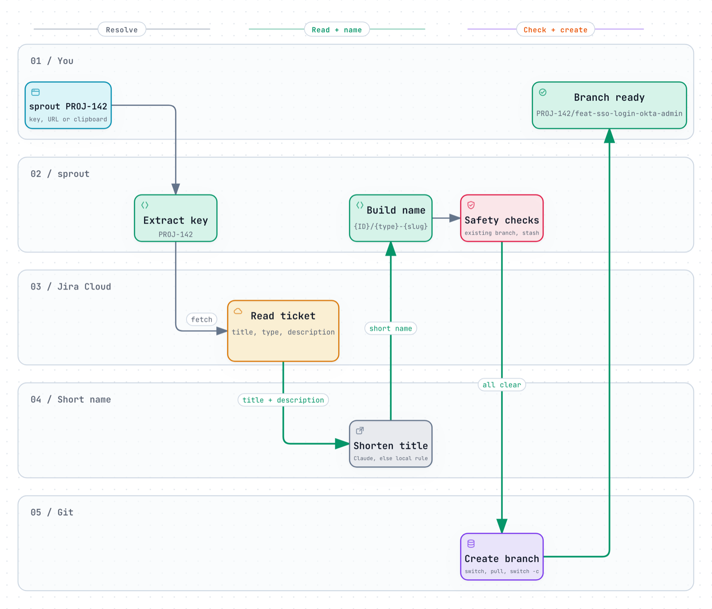

<div align="center">



<br>

### Turn a Jira ticket into a clean Git branch.<br>One command. A short, descriptive name. Zero copy-pasting.

<br>

[](https://github.com/beenjii14/sprout/actions/workflows/ci.yml)
[](https://github.com/beenjii14/sprout/releases)
[](#-install)
[](https://www.zsh.org/)
[](LICENSE)

**[🌐 Website](https://beenjii14.github.io/sprout/)** &nbsp;·&nbsp;
**[⚡ Install](#-install)** &nbsp;·&nbsp;
**[🎮 Usage](#-usage)** &nbsp;·&nbsp;
**[⚙️ Configuration](#%EF%B8%8F-configuration)** &nbsp;·&nbsp;
**[❓ FAQ](#-faq)**

<br>



</div>

<br>

## ✨ Why sprout

Every ticket starts the same way: open Jira, copy the key, invent a branch name, remember the team convention,
switch to the base branch, pull, create the branch. Do that ten times a week and your branches drift into
`fix-bug`, `PROJ-142-sso` and `feature/SSO_login_FINAL`.

**sprout does the whole routine in one step, and keeps names consistent.**

| | |
| --- | --- |
| 🎫 **One command** | `sprout PROJ-142`, or paste a Jira URL, or just run `sprout` with a link on your clipboard. |
| 🔎 **Reads Jira for you** | Title, issue type and description become the branch name and the `feat` / `fix` / `chore` prefix. |
| 🌱 **Short, descriptive, in English** | With [Claude](https://claude.com/claude-code) installed, long titles become 2–5 meaningful words, translated to English by default. Without it, a local rule does the job. |
| 🛡️ **Careful with your work** | Offers to stash uncommitted changes, reuses an existing branch for the ticket, and stops at the first Git error. |
| ⚙️ **Yours to configure** | Branch format, language, base branch and remote. |
| 🔐 **Secrets stay secret** | Your API token lives in the macOS Keychain or libsecret, never in a config file. |

<br>

## 🚀 Quick start

```sh
# 1. Install
brew tap beenjii14/tap && brew trust beenjii14/tap && brew install sprout

# 2. Guided setup (Jira site, email, API token, base branch)
sprout-setup

# 3. In any repository, branch from a ticket
sprout PROJ-142
```

> [!TIP]
> Not sure what name you will get? Add `--dry-run` to preview it without touching Git: `sprout --dry-run PROJ-142`.

<br>

## 🧭 How it works

<div align="center">
<picture>
  <source media="(prefers-color-scheme: dark)" srcset="docs/assets/how-it-works-dark.png">
  
</picture>

<sub>Interactive version: <a href="https://beenjii14.github.io/sprout/diagrams/how-it-works.html">open the diagram</a></sub>
</div>

<br>

## 📦 Install

### Requirements

| Tool | Why | Notes |
| --- | --- | --- |
| `zsh` | the plugin runs in zsh | default shell on macOS |
| `git` | creates the branches | |
| `curl`, `jq` | talk to Jira | only needed for ticket lookups |
| `perl` | accent-safe slugs | preinstalled on macOS and most Linux |
| [`claude`](https://claude.com/claude-code) | *optional*: smarter, translated names | without it, a local rule shortens the title |

Supported: macOS and Linux, Jira Cloud (API v3, API-token authentication). Using `sprout` with an explicit title needs no Jira at all.

### 🍺 Homebrew (recommended)

```sh
brew tap beenjii14/tap
brew trust beenjii14/tap     # Homebrew 7+ asks you to trust third-party taps
brew install sprout
sprout-setup                 # guided setup: Jira site, email, token, base branch
```

`sprout-setup` asks for your Jira site, email, API token and base branch (and, only if `claude` is installed, whether to
use it for names), stores your token in the macOS Keychain, writes `~/.config/sprout/config`, adds the loader to
your `~/.zshrc` and verifies the Jira connection. Open a new terminal afterwards. Upgrade with `brew upgrade sprout`.

<details>
<summary><b>Other ways to install</b></summary>

<br>

**One-liner (no Homebrew)**

```sh
curl -fsSL https://raw.githubusercontent.com/beenjii14/sprout/main/install.sh | bash
```

Does the same as `sprout-setup` and also copies the plugin to `~/.local/share/sprout`. Safe to re-run.

**From a clone (read it first)**

```sh
git clone https://github.com/beenjii14/sprout.git
cd sprout
./install.sh
```

**Plugin managers**

```sh
# zinit
zinit light beenjii14/sprout

# antidote (.zsh_plugins.txt)
beenjii14/sprout

# Oh My Zsh: clone into a custom plugin folder named "sprout", then add it to plugins=(... sprout)
git clone https://github.com/beenjii14/sprout.git ~/.oh-my-zsh/custom/plugins/sprout
```

With a plugin manager, set your options in `~/.config/sprout/config` or export them in `~/.zshrc`
(see [Configuration](#%EF%B8%8F-configuration)) and store your token with the commands in [Credentials](#-credentials).

**Manual**

```sh
curl -fsSL https://raw.githubusercontent.com/beenjii14/sprout/main/sprout.plugin.zsh -o ~/.sprout.plugin.zsh
echo 'source ~/.sprout.plugin.zsh' >> ~/.zshrc
```

</details>

<details>
<summary><b>Uninstall</b></summary>

<br>

```sh
sprout-uninstall && brew uninstall sprout                                                  # Homebrew
curl -fsSL https://raw.githubusercontent.com/beenjii14/sprout/main/uninstall.sh | bash     # other methods
```

The uninstaller removes the loader from `~/.zshrc` and the plugin; it asks before deleting your configuration and your stored token.

</details>

<br>

## 🎮 Usage

```text
sprout [options] [<KEY|URL>] ["<title>"] [<type>]
```

```sh
sprout PROJ-142                        # title and type come from Jira
sprout PROJ-142 "Add login page"       # you give the title, no Jira lookup
sprout PROJ-142 "Crash on start" fix   # explicit type (feat | fix | chore)
sprout https://acme.atlassian.net/browse/PROJ-142
sprout                                 # uses the Jira URL or key on your clipboard
sprout PROJ-142 --base develop         # branch off develop, just this once
sprout PROJ-142 --no-pull              # skip the pull (offline work)
sprout --dry-run PROJ-142              # print the branch name, do not touch Git
```

**What happens when you run it for real**

1. `git switch <base>` → `git pull <remote> <base>` → `git switch -c <new-branch>`, stopping at the first failure.
2. If a branch for that ticket already exists, `sprout` offers to switch to it instead of creating a second one.
3. If you have uncommitted changes, `sprout` offers to stash them and restore them on the new branch.

| Flag | Meaning |
| --- | --- |
| `-b`, `--base <branch>` | Start from this branch instead of the configured base (also `--base=<branch>`) |
| `-r`, `--remote <name>` | Pull from this remote instead of the configured one |
| `--no-pull` | Skip the pull for this run |
| `-n`, `--dry-run` | Print the branch name only |
| `-h`, `--help` | Show help |
| `-v`, `--version` | Show the version |

### 🏷️ How the name is built

```text
 PROJ-142 / feat - sso-login-okta-admin
 └──┬───┘   └─┬─┘   └────────┬─────────┘
   ID      type            slug
```

| Part | Where it comes from |
| --- | --- |
| **ID** | The issue key, upper-cased. From a URL it is read from `/browse/KEY` or `?selectedIssue=KEY`, so host names like `my-org-2.atlassian.net` are never mistaken for a ticket. |
| **type** | Your argument, else derived from the Jira issue type: Bug / Defect / Incident → `fix`; Tech / Sub-task / Spike / Chore → `chore`; everything else → `feat`. |
| **slug** | Lowercase, accents stripped (`ñandú` → `nandu`), every non `[a-z0-9]` run becomes `-`, trimmed, max 50 characters. When the title comes from Jira, it is first condensed to 2–5 key words, in English unless you set `SPROUT_LANG`. |

<br>

## ⚙️ Configuration

Put these in `~/.config/sprout/config` (written by the installer) or export them in your shell.
**Exported variables win** over the file.

| Variable | Default | Description |
| --- | --- | --- |
| `SPROUT_JIRA_HOST` | *none* | Jira Cloud site, e.g. `your-team.atlassian.net`. Without it, `sprout` never calls Jira. |
| `JIRA_EMAIL` | `git config user.email` | Atlassian account email used with the API token. |
| `JIRA_API_TOKEN` | *keychain* | Overrides the stored token (handy for CI or containers). |
| `SPROUT_BASE` | remote default branch, else `main` | Branch to start from (`main`, `develop`, `qa`…). `--base` overrides it for one run. |
| `SPROUT_REMOTE` | `origin` | Remote used for the pull. `--remote` overrides it for one run. |
| `SPROUT_PULL` | `1` | Set to `0` to skip the pull (offline work). `--no-pull` does it for one run. |
| `SPROUT_BRANCH_FORMAT` | `{ID}/{type}-{slug}` | Branch template. Placeholders: `{ID}`, `{type}`, `{slug}`. |
| `SPROUT_TYPES` | `feat fix chore` | Allowed types, space-separated. |
| `SPROUT_AI` | `1` | Set to `0` to disable Claude-based shortening. |
| `SPROUT_AI_MODEL` | `haiku` | Model passed to `claude -p`. |
| `SPROUT_LANG` | `en` | Language of AI-generated names: `en`, `es`, `pt`, `fr`, `de`, `it`, any language name, or `ticket` to keep the ticket's own language. |
| `SPROUT_COMMAND` | `sprout` | Rename the command if it clashes with another tool. |
| `SPROUT_DRY_RUN` | *unset* | Any value behaves like `--dry-run`. |
| `SPROUT_CONFIG` | `~/.config/sprout/config` | Alternative config file path. |

Example `~/.config/sprout/config`:

```sh
export SPROUT_JIRA_HOST="acme.atlassian.net"
export JIRA_EMAIL="you@acme.com"
export SPROUT_BASE="develop"
export SPROUT_BRANCH_FORMAT="{type}/{ID}-{slug}"     # feat/PROJ-142-sso-login-okta-admin
export SPROUT_TYPES="feat fix chore docs refactor"
```

### 🔐 Credentials

Create an API token at <https://id.atlassian.com/manage-profile/security/api-tokens>. The installer
stores it for you; to do it by hand:

```sh
# macOS (prompts for the value, nothing lands in your shell history)
security add-generic-password -U -a "$USER" -s sprout-jira-token -w

# Linux (libsecret)
secret-tool store --label="sprout Jira API token" service sprout-jira-token

# anywhere: export it (keep it out of version control)
export JIRA_API_TOKEN="..."
```

`sprout` looks for the token in this order: `JIRA_API_TOKEN` → macOS Keychain → libsecret → `~/.config/sprout/token` (mode `600`).
The token is handed to `curl` over stdin, so it never shows up in `ps`. Revoke it any time from the Atlassian page above.

<br>

## 🤖 AI-assisted names and privacy

When `claude` (the [Claude Code CLI](https://claude.com/claude-code)) is installed and `SPROUT_AI` is not `0`,
`sprout` sends **the ticket title and the first 1,500 characters of its description** to Anthropic through that CLI to get a
2–5 word name. The prompt tells the model to base the name on the title, keep proper nouns and technologies,
never invent concepts, and write the name in English by default (a Spanish ticket becomes an English branch name;
change it with `SPROUT_LANG`). The answer is validated (`[a-z0-9-]` only, 3–40 characters); if it fails, times out (25 s)
or looks wrong, `sprout` falls back to a local heuristic that drops stop-words and keeps the first four meaningful words
(the heuristic cannot translate, so it keeps the ticket's own words).

**Language.** Names are written in English by default, so a ticket titled *"Agregar login con SSO para el panel de administración"*
becomes something like `admin-panel-sso-login`. Set `SPROUT_LANG` to `es`, `pt`, `fr`, `de`, `it`, any language name, or `ticket`
to keep the ticket's own language.

> [!NOTE]
> **No `claude`? No problem.** `sprout` checks for the command on every run. If it is missing, or `SPROUT_AI=0`, the local rule is used and everything else works the same.
> `sprout-setup` writes `SPROUT_AI=0` to your config when you decline the question or `claude` is not installed yet;
> install `claude` later and set `SPROUT_AI=1` (or delete that line) to turn it on.

> [!IMPORTANT]
> Working with confidential tickets? Set `SPROUT_AI=0`. Nothing but the Jira request then leaves your machine.

Because the answer can vary between runs, `sprout` checks for an existing branch for the same ticket before creating another.

<br>

## ❓ FAQ

<details>
<summary><b>The <code>sprout</code> command clashes with something else on my machine.</b></summary>

<br>

Set `export SPROUT_COMMAND=sp` (any name) in `~/.config/sprout/config` and open a new shell. The command and its completion follow the new name.
</details>

<details>
<summary><b>What language are the branch names in?</b></summary>

<br>

English by default, even for Spanish (or other) tickets, when Claude is available. Change it with `SPROUT_LANG` (`es`, `pt`, `fr`, `de`, `it`, any language name) or use `SPROUT_LANG=ticket` to keep the ticket's language. When you pass the title yourself, it is used as-is.
</details>

<details>
<summary><b>What if I do not have Claude installed?</b></summary>

<br>

`sprout` still works: it shortens the title with a local rule (drops stop-words, keeps the first four meaningful words) and keeps the ticket's own words, with no translation.
</details>

<details>
<summary><b>Does it work with Jira Server / Data Center?</b></summary>

<br>

Not yet: the lookup uses the Jira Cloud REST API v3. Passing the title yourself (`sprout KEY "title"`) works anywhere. Pull requests welcome.
</details>

<details>
<summary><b>Tab completion does not show up.</b></summary>

<br>

Completion registers itself only if `compdef` exists, so source the plugin *after* `compinit` in your `~/.zshrc`.
</details>

<details>
<summary><b>"could not fetch KEY from Jira".</b></summary>

<br>

Check, in order: `SPROUT_JIRA_HOST` is your site (no `https://` needed), `JIRA_EMAIL` is the Atlassian account email that owns the token, the token is stored (see [Credentials](#-credentials)) and that account can open the project. Run
`curl -u "$JIRA_EMAIL:<token>" https://<host>/rest/api/3/myself` to confirm the credentials work.
</details>

<details>
<summary><b>Can I use bash or fish?</b></summary>

<br>

`sprout` is a zsh plugin. bash and fish are not supported.
</details>

<br>

## 🧪 Tests

```sh
zsh tests/run.zsh
```

The suite is offline: it covers key extraction, slugging, formats, the AI language rule, error paths and a real Git flow in temporary repositories.

<br>

## 🤝 Contributing

Issues and pull requests are welcome; see [CONTRIBUTING.md](CONTRIBUTING.md) and the [Code of Conduct](CODE_OF_CONDUCT.md). Security issues: see [SECURITY.md](SECURITY.md).

Ideas on the wishlist: Jira Server/Data Center support, GitLab/GitHub issue keys and fish support.

<br>

<div align="center">

**If sprout saves you a few minutes every day, a ⭐ on the repo is the nicest thank-you.**

[MIT](LICENSE) © 2026 [Benjamin Cruz](https://github.com/beenjii14) &nbsp;·&nbsp; [Website](https://beenjii14.github.io/sprout/) &nbsp;·&nbsp; [Changelog](CHANGELOG.md)

</div>
